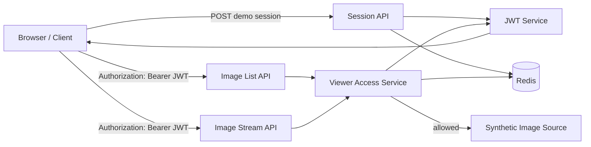

# JWT + Redis Image Viewer Portfolio

금융 전자문서 조회 경험을 바탕으로 **JWT 기반 요청 검증 + Redis 기반 Viewer Session + 이미지 목록/Streaming 조회**를 Clean-room 방식으로 재구성한 포트폴리오입니다.

> 이 저장소는 회사/고객사 소스, 실제 JWT Claim, Redis Key, TTL, URL, DB 스키마, 이미지 경로, 내부 로그 또는 설계서를 복사하지 않습니다.  
> 아래 Token/Session 구조와 Redis Key/TTL은 **포트폴리오용으로 새로 설계한 예시**이며 실제 운영 구조와 동일하다고 주장하지 않습니다.

## 이 저장소가 증명하는 것

- Java 8 / Spring 4 기반 Backend API 구조
- JWT 서명·만료·Audience 검증
- JWT의 `sid`와 Redis Viewer Session 연계
- Redis TTL 기반 조회 컨텍스트 수명 관리
- 이미지 목록 조회와 개별 Streaming 요청의 권한 일관성
- Token 자체에 과도한 업무 데이터를 넣지 않고 서버 측 상태를 Redis로 관리하는 설계
- 조회 권한 철회 시 Redis Session 삭제를 통한 즉시 차단 개념
- 실제 금융정보 대신 Synthetic Data만 사용하는 공개 포트폴리오 설계

## Portfolio Context

실제 업무에서는 JWT와 Redis를 활용해 **이미지 목록 조회와 Viewer를 연계**한 경험이 있습니다.

현재 외부 공개 가능한 사실은 그 범위까지이며, 다음 정보는 회사 내부 구현이거나 Career Master에서 확정되지 않았기 때문에 이 저장소에서 그대로 재현하지 않습니다.

- 실제 JWT 발급 주체 / Claim
- 실제 만료시간
- Refresh Token 사용 여부
- Redis에 저장한 실제 Value 구조
- 실제 Redis Key Naming
- 실제 권한검증 위치
- 실제 이미지 Repository / Storage Path
- 실제 URL / Host / Port

따라서 이 저장소는 위 경험을 설명하기 위한 **독립적인 Reference Architecture**입니다.

## Architecture



## 핵심 설계

### 1. JWT는 식별 정보만 전달

샘플 JWT에는 다음 정도만 넣습니다.

```text
sub : demo user
sid : viewer session id
iss : portfolio-image-service
aud : portfolio-image-viewer
iat / exp
```

이미지 목록 전체나 내부 경로를 JWT Claim에 넣지 않습니다.

### 2. Redis가 조회 컨텍스트를 관리

샘플 Redis Key:

```text
portfolio:viewer-session:{sid}
```

Value:

```json
{
  "sessionId": "random-uuid",
  "userId": "demo-user",
  "allowedImageIds": ["IMG-DEMO-001", "IMG-DEMO-002"],
  "expiresAtEpochSecond": 1234567890
}
```

Key와 TTL은 **포트폴리오용 예시**입니다.

### 3. JWT만 통과해도 이미지가 열리지는 않음

요청마다 다음을 검증합니다.

1. JWT Signature
2. `exp`
3. `iss`
4. `aud`
5. `sid`
6. Redis Session 존재 여부
7. JWT `sub`와 Redis `userId` 일치 여부
8. 요청한 `imageId`가 Session 허용 목록에 포함되는지

### 4. URL에 JWT를 넣지 않음

예제는 다음처럼 Bearer Header를 사용합니다.

```http
Authorization: Bearer <token>
```

URL Query String에 Token을 넣으면 Proxy/Access Log/Browser History 등에 노출될 수 있어 샘플에서는 사용하지 않습니다.

## API Flow

### Demo session 발급

```http
POST /api/demo/session
Content-Type: application/json
```

```json
{
  "userId": "demo-user",
  "imageIds": ["IMG-DEMO-001", "IMG-DEMO-002"]
}
```

응답:

```json
{
  "accessToken": "<JWT>",
  "expiresInSeconds": 300
}
```

`300초`는 포트폴리오 샘플 값입니다.

### 이미지 목록

```http
GET /api/images
Authorization: Bearer <JWT>
```

### 이미지 Streaming

```http
GET /api/images/IMG-DEMO-001/stream
Authorization: Bearer <JWT>
```

실제 이미지 대신 동적으로 만든 Synthetic SVG를 Streaming합니다.

## 실행

요구사항:

- JDK 8+
- Maven 3.8+
- Redis

로컬 Redis 예시:

```bash
docker compose up -d
```

JWT Secret:

```bash
export PORTFOLIO_JWT_SECRET='replace-with-a-long-random-demo-secret'
```

실행:

```bash
mvn test
mvn package
```

WAR를 Servlet Container(Tomcat 등)에 배포합니다.

## Repository Structure

```text
src/main/java/.../config
src/main/java/.../controller
src/main/java/.../model
src/main/java/.../security
src/main/java/.../service
src/main/java/.../store
src/test/java
docs/adr
docs/architecture.md
docs/security-flow.md
```

## Interview Talking Points

- JWT만으로 Stateful 조회를 처리하지 않고 Redis를 같이 사용하는 이유는?
- JWT Claim과 Redis Value를 어떻게 나눌 것인가?
- JWT는 유효하지만 Redis Session이 삭제된 경우 어떻게 처리할 것인가?
- Token TTL과 Redis TTL은 어떻게 맞출 것인가?
- 이미지별 Authorization은 어느 계층에서 검증할 것인가?
- Viewer URL에 Token을 직접 넣지 않는 이유는?
- Redis 장애 시 Fail-open / Fail-close 중 어떤 정책이 적절한가?
- 이미지 Streaming 요청이 많을 때 Application Memory 사용을 어떻게 관리할 것인가?

## Confidentiality Boundary

자세한 공개 기준은 [`SECURITY.md`](SECURITY.md)를 참고합니다.

**원칙: 경험의 개념과 판단은 공개하되, 회사의 구현물은 공개하지 않습니다.**
