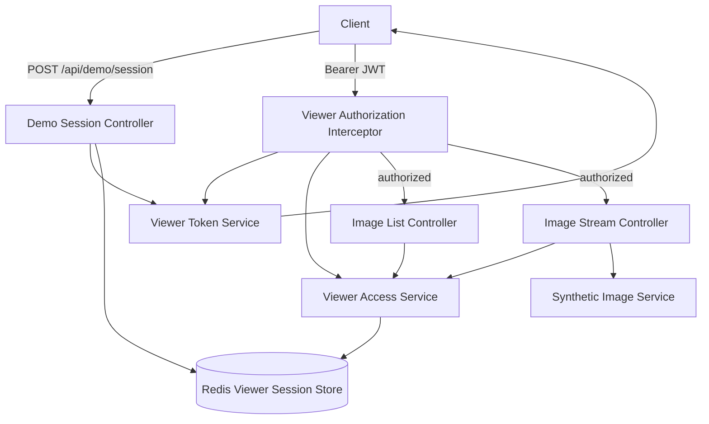

# Architecture

## Responsibility

- `ViewerTokenService`: JWT issue / signature / issuer / audience / expiry validation
- `ViewerSessionStore`: Server-side viewer context abstraction
- `RedisViewerSessionStore`: Redis implementation
- `ViewerAccessService`: JWT + Redis context consistency and resource authorization
- `ViewerAuthorizationInterceptor`: Shared request authorization entry point
- `ImageController`: Image list / streaming HTTP API
