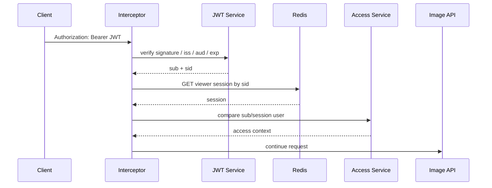

# Security Flow

## Request authorization

## Image authorization

For `/api/images/{imageId}/stream`, the application additionally checks whether the requested `imageId` exists in the Redis viewer session's allowed image set.

## Fail policy

This sample is Fail-closed.

- Invalid JWT -> 401
- Expired JWT -> 401
- Missing Redis session -> 401
- Subject/session mismatch -> 401
- Image not allowed -> 403
